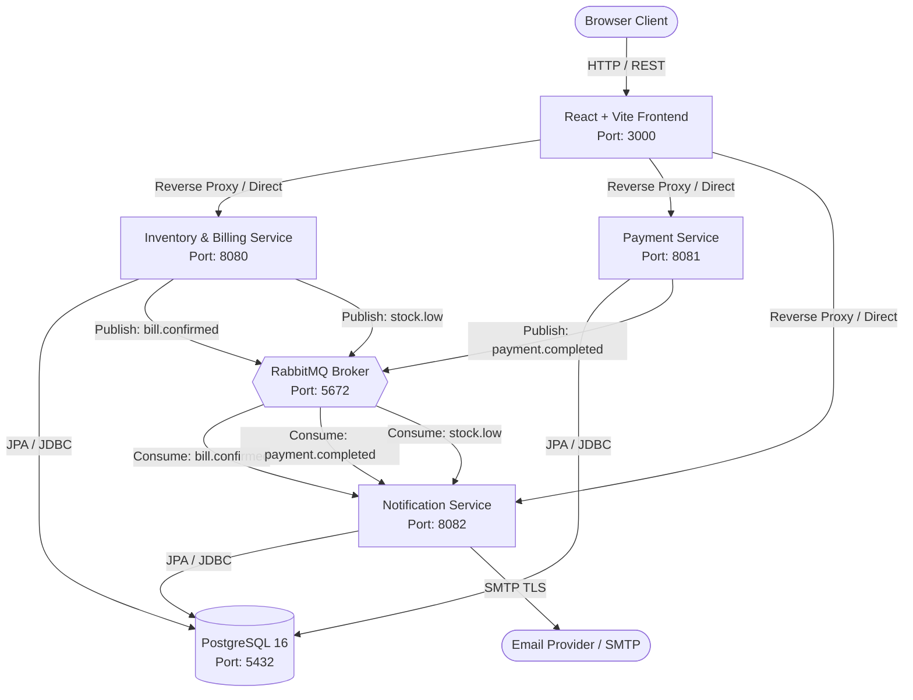

# Smart Inventory & Billing Management System

[](https://www.oracle.com/java/)
[](https://spring.io/projects/spring-boot)
[](https://react.dev/)
[](https://tailwindcss.com/)
[](https://www.postgresql.org/)
[](https://www.rabbitmq.com/)
[](https://www.docker.com/)

**Version:** 1.0.0 &bull; **Architecture:** Distributed Microservices &bull; **Status:** Production Ready

---

## 📋 Overview

The **Smart Inventory & Billing Management System** is an enterprise-grade, event-driven SaaS platform designed for high-volume retail and warehouse inventory management, point-of-sale (POS) billing, and automated customer communication. 

Engineered with a **Java 21 / Spring Boot 3** microservices backend, an asynchronous **RabbitMQ** event broker, and a responsive **React 19 / Tailwind CSS** interface, the platform demonstrates industry-standard distributed systems patterns including event-driven choreography, idempotent consumers, database isolation, structured error handling, and production-grade CORS security.

---

## ✨ Key Features

- **⚡ High-Speed Point of Sale (POS)**: Real-time cart calculations, instant inventory deduction, multiple payment methods (Cash, UPI, Card), and automated bill numbering.
- **📦 Inventory & Stock Control**: Real-time tracking of on-hand inventory, minimum reorder thresholds, low-stock warnings, and historical stock movements.
- **🚚 Supplier & Purchase Orders**: Purchase order generation, vendor management, receiving workflows, and unit cost adjustments.
- **📬 Automated Email & PDF Receipts**: Event-driven customer invoice dispatches via Gmail/SMTP upon payment confirmation.
- **🛡️ Supplier Requisition Workflow**: Automated low-stock alerts sent to suppliers with owner approval checks and dispatch tracking.
- **📊 Real-Time Analytics & Reports**: Live sales summaries, daily/monthly revenue trends, payment mode distributions, and stock valuation KPIs.
- **🎨 Modern SaaS UI**: Floating icon rail, responsive data tables with zero horizontal overflow on desktop, and a curated dual-tone dark mode with smooth radial reveal.

---

## 🖼️ User Interface & Dashboard Showcase

The frontend interface is inspired by high-end enterprise SaaS applications (Linear, Stripe, Raycast):

| View | Description | Highlights |
|---|---|---|
| **POS Terminal** | Point-of-Sale billing screen | Live product search, category chips, cart total calculation, multi-mode payment dialog |
| **Sales History** | Invoice audit log | Filter by payment/bill status, PDF receipt generation, email status tracking |
| **Product Catalog** | Inventory items & pricing | Compact responsive table, tooltip hover preview, SKU code formatting, quick status toggling |
| **Stock Control** | Inventory health monitor | Visual stock health badges, reorder threshold alerts, quick restock adjustments |
| **Notifications Audit** | Email dispatch logs | Real-time audit log of customer invoice emails and owner approval for low-stock supplier requisitions |
| **Reports & Analytics** | Executive business overview | Live revenue area charts, top-selling products, category distribution, valuation KPIs |

---

## 🛠️ Technology Stack

| Layer | Technologies |
|---|---|
| **Frontend** | React 19, Vite, Tailwind CSS v4, Framer Motion, Lucide Icons, Axios |
| **Backend Microservices** | Java 21, Spring Boot 3.3.5, Spring Data JPA, Spring AMQP, Spring Mail, Maven |
| **Database** | PostgreSQL 16 (Relational schema, foreign keys, indexes, triggers) |
| **Messaging Broker** | RabbitMQ 3.13 (Topic/Direct exchange, durable queues, DLQ pattern) |
| **Containerization** | Docker, Docker Compose, Multi-stage Dockerfiles, Nginx Alpine |
| **Security & Observability** | Configurable CORS Filter, Spring Boot Actuator health probes, SLF4J logging |

---

## 🏗️ Architecture & Communication

The system follows an asynchronous, event-driven microservices architecture:



---

## 🔄 RabbitMQ Event Choreography

All inter-service notifications and billing side-effects run asynchronously through RabbitMQ:

| Event | Producer | Routing Key | Consumer | Action Triggered |
|---|---|---|---|---|
| `PaymentCompletedEvent` | `payment-service` | `payment.completed` | `notification-service` | Renders HTML/PDF invoice and sends receipt email to customer |
| `LowStockDetectedEvent` | `inventory-service` | `stock.low` | `notification-service` | Creates pending low-stock notification; dispatches purchase requisition to supplier upon approval |
| `BillConfirmedEvent` | `inventory-service` | `bill.confirmed` | `notification-service` | Audits bill finalization and updates status counters |

---

## 📡 REST API Documentation

For the full detailed specification including request/response schemas, refer to [API_SPECIFICATION.md](file:///c:/Users/Asus/Documents/Smart_Inventory_And_Billing_Management_System/API_SPECIFICATION.md).

### 1. Inventory & Billing Service (`http://localhost:8080`)
| Method | Endpoint | Description |
|---|---|---|
| `GET` | `/api/v1/products` | Paginated product search & catalog listing |
| `POST` | `/api/v1/products` | Create new product with initial inventory |
| `PUT` | `/api/v1/products/{id}` | Update product details & pricing |
| `GET` | `/api/v1/bills` | Search sales invoices with date & status filters |
| `POST` | `/api/v1/bills` | Create and draft new customer bill |
| `PUT` | `/api/v1/bills/{id}/confirm` | Confirm bill, deduct stock, and emit RabbitMQ event |
| `GET` | `/api/v1/inventory` | Real-time stock counts and low-stock alerts |
| `POST` | `/api/v1/inventory/adjust` | Manual inventory adjustment |
| `GET` | `/api/v1/reports/sales` | Aggregated revenue, average bill, and sales metrics |

### 2. Payment Service (`http://localhost:8081`)
| Method | Endpoint | Description |
|---|---|---|
| `POST` | `/api/v1/payments` | Process and record payment for an invoice |
| `GET` | `/api/v1/payments/{id}` | Retrieve payment status & transaction details |
| `GET` | `/api/v1/payments/bill/{billId}` | Get payment history for a specific bill |

### 3. Notification Service (`http://localhost:8082`)
| Method | Endpoint | Description |
|---|---|---|
| `GET` | `/api/v1/notifications` | Paginated email dispatch audit log |
| `GET` | `/api/v1/notifications/{id}` | Preview generated HTML email & recipient info |
| `PUT` | `/api/v1/notifications/{id}/approve` | Owner approval to dispatch low-stock supplier email |
| `POST` | `/api/v1/notifications/{id}/retry` | Retry failed email dispatch |
| `GET` | `/api/v1/notifications/actionable-count` | Real-time count of pending notifications for badge |

---

## 📂 Project Structure

```
Smart_Inventory_And_Billing_Management_System/
├── backend/
│   ├── pom.xml                               # Parent Maven Aggregator POM
│   ├── inventory-service/                    # Port 8080 — Core billing & inventory
│   │   ├── Dockerfile
│   │   └── src/main/java/com/smartinventory/inventoryservice/
│   │       ├── config/                       # CorsConfig, RabbitMQConfig
│   │       ├── controller/                   # REST endpoints
│   │       ├── dto/                          # Request/Response payloads
│   │       ├── entity/                       # JPA entities
│   │       ├── event/                        # AMQP event publishers
│   │       ├── repository/                   # Spring Data repositories
│   │       └── service/                      # Transactional business logic
│   ├── payment-service/                      # Port 8081 — Payment processing
│   │   ├── Dockerfile
│   │   └── src/main/java/com/smartinventory/payment/
│   │       ├── config/                       # CorsConfig
│   │       ├── controller/                   # Payment REST APIs
│   │       └── service/                      # Payment validation & event emission
│   └── notification-service/                 # Port 8082 — Email & audit log
│       ├── Dockerfile
│       └── src/main/java/com/smartinventory/notificationservice/
│           ├── config/                       # CorsConfig, RabbitMQConfig
│           ├── consumer/                     # RabbitMQ listeners
│           └── service/                      # SMTP dispatch & approval workflows
├── frontend/                                 # Port 3000 — React 19 Client
│   ├── Dockerfile                            # Multi-stage Nginx Alpine build
│   ├── nginx.conf                            # Production SPA reverse proxy
│   ├── src/
│   │   ├── components/                       # Card, Table, PageContainer, Modal
│   │   ├── layouts/                          # MainLayout (collapsible rail, header)
│   │   ├── pages/                            # Dashboard, Products, Sales, etc.
│   │   ├── services/                         # Centralized Axios apiClient
│   │   └── context/                          # ThemeContext, ToastContext
│   ├── .env.example
│   └── .env.production.example
├── database/                                 # Initial SQL scripts
│   ├── schema.sql                            # Tables, indexes, constraints
│   └── seed.sql                              # Initial demo data & catalogs
├── .env.example                              # Root local environment template
├── .env.production.example                   # Production deployment template
├── docker-compose.yml                        # Full-stack composition (6 services)
└── README.md
```

---

## 🚀 Quick Start with Docker (Recommended)

Start the entire system (Database, Message Broker, 3 Microservices, and Frontend Client) with one command:

### 1. Prerequisites
- [Docker Desktop](https://www.docker.com/products/docker-desktop/) (v24+ with Compose v2)

### 2. Configure Environment
```bash
cp .env.example .env
```
*(Optionally set your Gmail SMTP credentials in `.env` if you wish to receive live test emails).*

### 3. Start All 6 Services
```bash
docker compose up -d --build
```

### 4. Service Dashboard & Access URLs

| Application / Service | URL / Port | Credentials / Health |
|---|---|---|
| **Frontend Web App** | `http://localhost:3000` | Ready out of the box |
| **Inventory Service API** | `http://localhost:8080/api/v1` | `http://localhost:8080/actuator/health` |
| **Payment Service API** | `http://localhost:8081/api/v1` | `http://localhost:8081/actuator/health` |
| **Notification Service API** | `http://localhost:8082/api/v1` | `http://localhost:8082/actuator/health` |
| **RabbitMQ Management** | `http://localhost:15672` | User: `guest` &bull; Pass: `guest` |
| **PostgreSQL Database** | `localhost:5432` | DB: `smart_inventory` &bull; User: `postgres` |

---

## 💻 Local Development (Without Docker)

### Prerequisites
- Java 21 JDK (Eclipse Temurin / Oracle)
- Maven 3.9+
- Node.js 20+ & npm
- PostgreSQL running locally (port 5432 or 5433)
- RabbitMQ running locally (port 5672)

### 1. Database Initialization
```bash
psql -U postgres -d postgres -c "CREATE DATABASE smart_inventory;"
psql -U postgres -d smart_inventory -f database/schema.sql
psql -U postgres -d smart_inventory -f database/seed.sql
```

### 2. Backend Services
Open separate terminals for each microservice:
```bash
# Terminal 1 — Inventory & Billing Service
cd backend/inventory-service
mvn spring-boot:run

# Terminal 2 — Payment Service
cd backend/payment-service
mvn spring-boot:run

# Terminal 3 — Notification Service
cd backend/notification-service
mvn spring-boot:run
```

### 3. Frontend Client
```bash
cd frontend
npm install
npm run dev
```
Open `http://localhost:3000` in your browser.

---

## 🔐 Environment Variables Reference

| Variable Name | Description | Default (Dev) | Production Example |
|---|---|---|---|
| `POSTGRES_DB` | PostgreSQL database name | `smart_inventory` | `smart_inventory_prod` |
| `POSTGRES_USER` | PostgreSQL master username | `postgres` | `inventory_admin` |
| `POSTGRES_PASSWORD` | PostgreSQL master password | `postgres` | `[Secure-Random-Password]` |
| `RABBITMQ_DEFAULT_USER` | RabbitMQ broker username | `guest` | `rabbit_admin` |
| `RABBITMQ_DEFAULT_PASS` | RabbitMQ broker password | `guest` | `[Secure-Rabbit-Password]` |
| `APP_CORS_ALLOWED_ORIGINS` | Permitted browser origins | `http://localhost:3000` | `https://inventory.yourdomain.com` |
| `SPRING_MAIL_HOST` | Outgoing SMTP server | `smtp.gmail.com` | `smtp.sendgrid.net` |
| `SPRING_MAIL_PORT` | Outgoing SMTP TLS port | `587` | `587` |
| `SPRING_MAIL_USERNAME` | SMTP account email | `your-email@gmail.com` | `notifications@yourdomain.com` |
| `SPRING_MAIL_PASSWORD` | SMTP password / App token | `your-app-password` | `[Secure-App-Password]` |
| `VITE_API_URL` | Frontend API gateway URL | *(Uses Vite Proxy)* | `https://api.yourdomain.com` |

---

## 🧪 Build & Quality Verification

### Frontend Verification
```bash
cd frontend
npm run build
```
- Compiles with 0 errors via Vite.

### Backend Verification
```bash
cd backend
mvn clean package -DskipTests
```
- Builds all 3 microservices and packages executable fat JARs into `target/`.

---

## 🌐 Production Deployment Guide

1. **Server Setup**: Provision an Ubuntu 22.04 / 24.04 LTS instance with Docker and Docker Compose installed.
2. **Clone & Configure**:
   ```bash
   git clone https://github.com/Dharma23012432/Smart_Inventory_And_Billing_Management_System.git
   cd Smart_Inventory_And_Billing_Management_System
   cp .env.production.example .env
   # Edit .env with your domain names and production secrets
   ```
3. **Launch**:
   ```bash
   docker compose up -d --build
   ```
4. **SSL / Reverse Proxy**: Set up Caddy or Nginx with Certbot on ports 80/443 pointing to container port 3000.

---

## 🔮 Roadmap & Future Improvements

- [ ] **Multi-Tenancy**: Organization and branch-level tenant partitioning with separate schemas or tenant IDs.
- [ ] **Barcode / QR Scanner Hardware Integration**: WebHID and camera-based barcode scanning for accelerated POS item lookups.
- [ ] **Payment Gateways**: Direct Stripe and Razorpay webhook integrations for automated card and UPI reconciliation.
- [ ] **Role-Based Access Control (RBAC)**: Fine-grained permissions (Cashier, Store Manager, Auditor, Admin) using Spring Security and JWT.
- [ ] **AI-Powered Demand Forecasting**: Predictive replenishment suggestions based on seasonal sales velocity and supplier lead times.

---

## 📄 License
This project is licensed under the MIT License.
